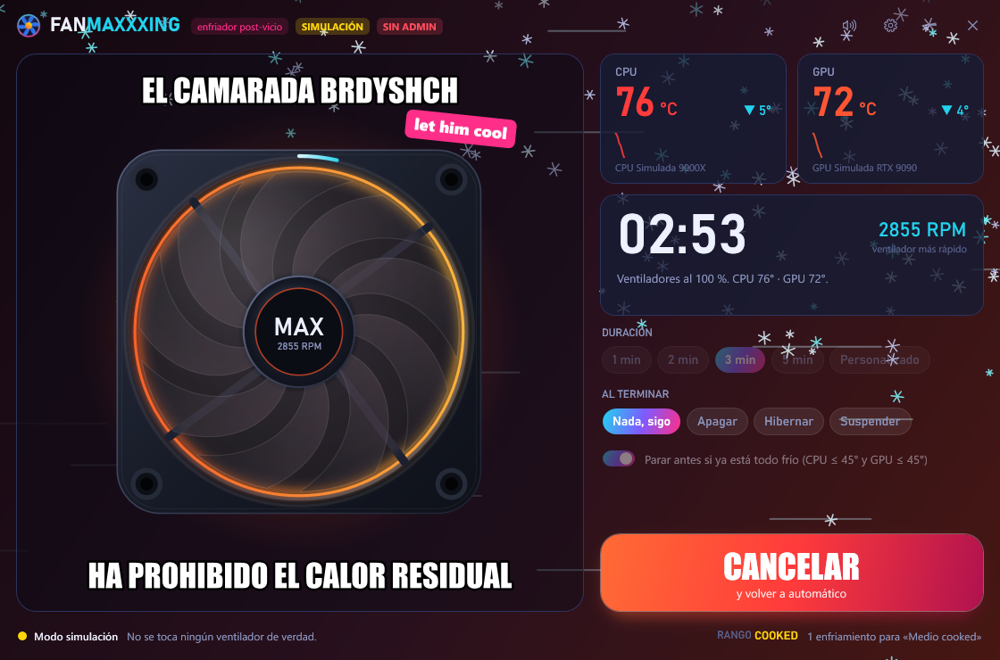

# FanMaxxxing 🌀❄

[English](README.md) · [Español](README.es.md)

**Enfriador post-vicio para Windows 10/11, libre y de código abierto.** Al terminar de jugar pone los ventiladores de CPU y GPU al 100 % unos minutos para sacar el calor residual. Después puede apagar, hibernar o suspender el PC, así tu hardware no se queda cociéndose toda la noche.

Además es un poco ridículo a propósito: memes actuales (FAAAH, 6 7, aura, la peace, frame-mogging…), un ventilador de 120 mm animado con anillo RGB que sigue tus temperaturas, partículas de nieve y viento, logros y rangos.

## Descargar e instalar

1. Entra en **[Releases](https://github.com/pabloAlvarezR/fanmaxxxing/releases/latest)**.
2. Descarga el instalador en tu idioma: `FanMaxxxing-x.y.z-Setup-es.msi` (español) o `…-en.msi` (inglés).
3. Ábrelo con doble clic. No hace falta nada más: .NET va incluido.

El instalador:
- instala en `C:\Program Files\FanMaxxxing`;
- crea accesos en el menú Inicio (*FanMaxxxing*, *Enfriar y apagar*, *Enfriar ahora*, *Modo simulación*, *Léeme*) y dos en el escritorio;
- se desinstala desde **Configuración › Aplicaciones**. Al desinstalar cierra la app si está abierta (devolviendo antes los ventiladores a la normalidad) y borra sus tareas programadas. Tus ajustes se quedan en `%LOCALAPPDATA%\FanMaxxxing`.

La app **busca actualizaciones al arrancar**. Si hay una Release nueva, aparece un aviso abajo con un botón **Actualizar** que descarga e instala el MSI nuevo.

> El instalador no está firmado digitalmente, así que Windows puede decir «Editor desconocido» o mostrar SmartScreen («Más información» → «Ejecutar de todas formas»).

## Cómo se usa

1. Abre **FanMaxxxing**, o *Enfriar y apagar* para empezar directamente. Pedirá permisos de administrador, igual que FanControl. Para que no pregunte cada vez, activa en Ajustes «Abrir sin que Windows pregunte permisos».
2. La primera vez, elige **idioma** y si quieres **sonido**.
3. Elige la **duración** (1, 2, 3 o 5 min, o **Personalizado** de 6 a 30 min) y qué hacer **al terminar**: nada, apagar, hibernar o suspender.
4. Pulsa **MAXXEAR**. Ventiladores al 100 %, Windows no se suspende a mitad y al acabar todo vuelve a automático.
5. Si elegiste apagar, hay una cuenta atrás cancelable (30 s por defecto).

> **Primera vez en tu PC gaming:** abre ⚙ Ajustes y pulsa **«🧪 Probar 10 segundos»**. Si oyes el despegue, todo está bien.

Al cerrar la ventana pregunta si estás seguro y cierra la app del todo (sin icono en la bandeja).

**Idiomas:** English, Español, Français, Deutsch, Italiano, Português, 简体中文. Cada uno tiene sus propios memes, no traducciones literales.

## Cómo controla los ventiladores

- **FanControl (recomendado):** usa el [FanControl de Rem0o](https://github.com/Rem0o/FanControl.Releases) por su línea de comandos oficial (`FanControl.exe -c config.json`):
  1. Genera una copia de tu config con todo en manual al 100 %.
  2. La carga y espera el tiempo elegido.
  3. Vuelve a cargar tu config normal.
- **Directo (experimental):** controla los ventiladores con [LibreHardwareMonitor](https://github.com/LibreHardwareMonitor/LibreHardwareMonitor). Necesita el driver PawnIO y FanControl cerrado.
- **Simulación:** `FanMaxxxing.exe --sim`. Temperaturas de mentira; nunca apaga el PC de verdad.

## Fiabilidad

- **Siempre vuelve a automático**, aunque canceles, haya un error o cierres la app.
- **Si la app muere a mitad**, al volver a abrirla restaura tu config de FanControl.
- **Si Windows se apaga a mitad**, restaura tu config antes de cerrarse.
- **Sin fugas de memoria**: probado con 28 enfriamientos seguidos, con memoria, handles y objetos GDI/USER estables.
- Animaciones a 40 fps como máximo, para no calentar la GPU que queremos enfriar.

## Haz fork, modifícalo, tradúcelo

FanMaxxxing tiene **licencia MIT**: haz fork y cambia lo que quieras. Los pull requests son bienvenidos.

- **Compilar** (necesita el SDK de .NET 8): `powershell -ExecutionPolicy Bypass -File .\build-installer.ps1` genera el exe en `publish\` y los MSI en `dist\`.
- **Añadir un idioma**:
  1. Copia `src/FanMaxxxing/Strings/en.json` a `<código>.json`.
  2. Traduce `strings` y escribe tus propios `memes`, `tags` y `ranks`.
  3. Regístralo en `Loc.Languages` (`Core/Loc.cs`).
  Las claves que falten salen en inglés.
- **Publicar versiones**:
  1. Sube `<Version>` en el `.csproj` y ejecuta el script.
  2. Crea una Release con etiqueta `vX.Y.Z` y adjunta los `.msi` con sufijo `-en` / `-es`.
  El comprobador de actualizaciones lee la última Release del repo indicado en `UpdateChecker.Repo`; en tu fork, cámbialo a `tu-usuario/tu-repo`. Solo funciona si el repositorio es **público**.

Más detalles (línea de comandos, estructura, problemas conocidos) en el [README en inglés](README.md).

## Licencia

[MIT](LICENSE). FanControl es software de código cerrado de Rémi Mercier y **no** va incluido; FanMaxxxing solo usa su línea de comandos pública. LibreHardwareMonitor tiene licencia MPL-2.0.
