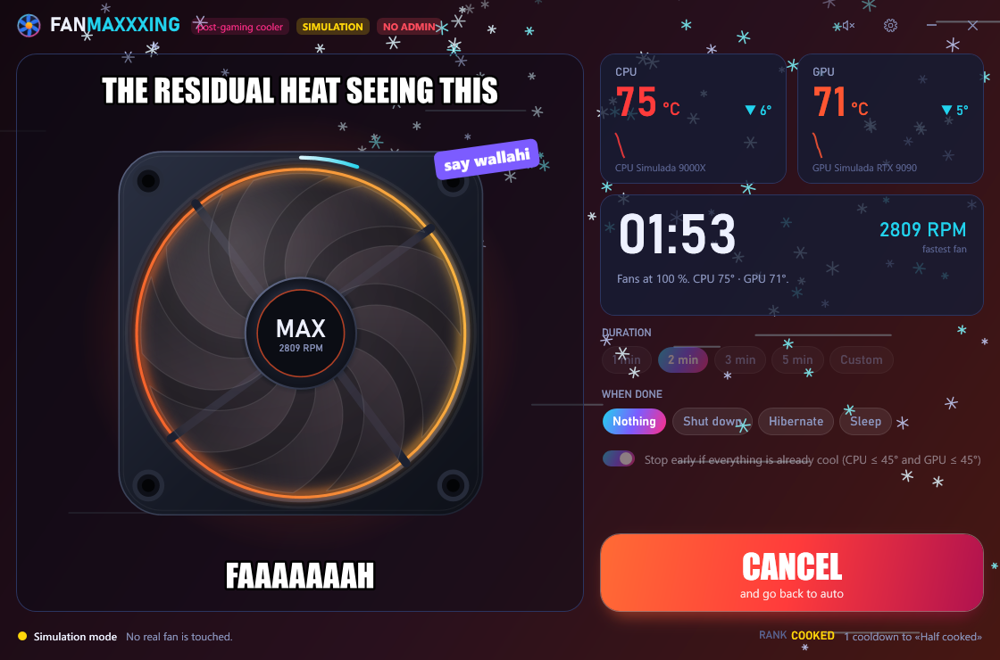

# FanMaxxxing 🌀❄

[English](README.md) · [Español](README.es.md)

**A free, open-source post-gaming PC cooler for Windows 10/11.** When you finish playing, it runs your CPU and GPU fans at 100 % for a few minutes to get rid of residual heat, and can then shut down, hibernate or sleep the PC. Your hardware doesn't sit there cooking all night.

It's also a bit ridiculous on purpose: current memes (FAAAH, 6 7, aura, la peace, frame-mogging…), an animated 120 mm fan whose RGB ring follows your temperatures, snow and wind particles, achievements and ranks.



## Download and install

1. Go to **[Releases](https://github.com/pabloAlvarezR/fanmaxxxing/releases/latest)**.
2. Download the installer in your language: `FanMaxxxing-x.y.z-Setup-en.msi` (English) or `…-es.msi` (Spanish).
3. Double-click it. Nothing else is needed: .NET is bundled.

The installer:
- installs to `C:\Program Files\FanMaxxxing`;
- adds Start menu shortcuts (*FanMaxxxing*, *Cool down and shut down*, *Cool down now*, *Simulation mode*, *README*) and two desktop shortcuts;
- can be removed from **Settings › Apps**. Uninstalling closes the app if it's running (restoring the fans first) and removes its scheduled tasks. Your settings stay in `%LOCALAPPDATA%\FanMaxxxing`.

The app **checks for updates at startup**. When a new release is published, a notice appears at the bottom with an **Update** button that downloads and installs the new MSI.

> The installer isn't code-signed, so Windows may show "Unknown publisher" or SmartScreen ("More info" → "Run anyway").

Silent install without desktop shortcuts:

```powershell
msiexec /i FanMaxxxing-1.2.0-Setup-en.msi /qb DESKTOPSHORTCUTS=0
```

## Usage

1. Open **FanMaxxxing**, or *Cool down and shut down* to start right away. It asks for administrator rights, like FanControl does. Enable "Open without UAC" in Settings to skip the prompt.
2. The first time, choose your **language** and whether you want **sound**.
3. Pick a **duration** (1, 2, 3 or 5 min, or **Custom** from 6 to 30 min) and what to do **when done**: nothing, shut down, hibernate or sleep.
4. Hit **MAXX IT**. Fans go to 100 %, Windows won't sleep in the middle, and everything returns to auto at the end.
5. If you chose to shut down, there's a cancellable countdown (30 s by default).

> **First time on your gaming PC:** open ⚙ Settings and click **"🧪 Test for 10 seconds"**. If you hear the take-off, you're set.

Closing the window asks for confirmation and exits the app completely (no tray icon).

**Languages:** English, Español, Français, Deutsch, Italiano, Português, 简体中文. Each one has its own memes, not literal translations.

## How it controls the fans

### FanControl engine (recommended)

Uses [FanControl by Rem0o](https://github.com/Rem0o/FanControl.Releases) through its official command line (`FanControl.exe -c config.json`, which switches configs live):

1. Reads **your normal config** from FanControl's `Configurations` folder ("Automatic" = the one FanControl saved last, i.e. your active one).
2. Generates a copy, `FanMaxxxing_MAX.json`, with every fan set to **manual 100 %**. Nothing else in your config changes.
3. Loads that copy, waits, then **reloads your normal config**.
4. If FanControl was closed when it started, it closes it again (optional).

In Settings you can untick fans you don't want at max (e.g. a pump) or use a MAX config you made by hand.

### Direct engine (experimental)

For people without FanControl. Controls motherboard and GPU fans with [LibreHardwareMonitor](https://github.com/LibreHardwareMonitor/LibreHardwareMonitor), the same library FanControl uses internally. Needs the **PawnIO** driver (FanControl installs it, or get it from pawnio.eu) and FanControl closed.

### Simulation

Fake temperatures to try the app without touching hardware: `FanMaxxxing.exe --sim`. Simulation **never** shuts down the PC.

## Reliability

- **Always returns to auto**: restoring happens in a `finally` block, so it runs on cancel, error or exit.
- **If the app dies mid-cooldown** (crash, killed process, power cut), a marker file lets it restore your FanControl config the next time it opens.
- **If Windows shuts down mid-cooldown**, it restores your config before exiting.
- **No memory leaks**: a single render loop that stops when the window is hidden or minimized, a fixed-size particle pool, frozen brushes, LibreHardwareMonitor history disabled, timers stopped and events unhooked on exit. Tested with 28 back-to-back cooldowns: flat managed memory (~3.8 MB) and stable handles and GDI/USER objects.
- Animations capped at 40 fps (24 in reduced mode), so the UI doesn't heat the GPU you're trying to cool.
- Rotating log (max 1 MB) in `%LOCALAPPDATA%\FanMaxxxing\log.txt`.

## Command line

```
FanMaxxxing.exe --start --minutes 5 --then shutdown
```

| Argument | What it does |
|---|---|
| `--start` | Start cooling right away |
| `--minutes N` | Duration (1-30) |
| `--then shutdown\|hibernate\|sleep\|nothing` | What to do when done |
| `--sim` | Simulation mode |
| `--no-elevate` | Don't ask for administrator rights |

If the app is already open, the new instance forwards the command and exits.

## Fork it, mod it, translate it

FanMaxxxing is **MIT-licensed**: fork it and change whatever you want. Pull requests are welcome.

### Build

Requires the **.NET 8 SDK**. WiX 5 (MS-RL license) is pulled from NuGet automatically.

```powershell
powershell -ExecutionPolicy Bypass -File .\build-installer.ps1
```

This publishes a self-contained single-file exe to `publish\` and builds `dist\FanMaxxxing-<version>-Setup-en.msi` and `-es.msi`.

### Add or improve a language

1. Copy `src/FanMaxxxing/Strings/en.json` to `<code>.json`, for example `nl.json`.
2. Translate `strings`, and write your own `memes`, `tags` and `ranks`. Local memes beat literal translations.
3. Register the language in `Loc.Languages` (`src/FanMaxxxing/Core/Loc.cs`).

Missing keys fall back to English.

### Publish your own releases (and updates)

The update checker reads the **latest GitHub Release** of the repo set in `UpdateChecker.Repo` (`src/FanMaxxxing/Core/UpdateChecker.cs`). In a fork, change it to `your-user/your-repo`. Then for each version:

1. Bump `<Version>` in `src/FanMaxxxing/FanMaxxxing.csproj`.
2. Run `build-installer.ps1`.
3. Create a Release tagged `vX.Y.Z` and attach the `.msi` files. Keep the `-en.msi` / `-es.msi` suffix: the app picks the one matching its language and falls back to English.

The update check only works if the repository is **public**.

### Project layout

```
src/FanMaxxxing/
  Core/      engines (FanControl, direct, simulation), cooldown, sensors, power, settings, updates, i18n
  UI/        animated fan, particles, meme text, temperature cards
  Strings/   language files (en, es, fr, de, it, pt, zh)
  MainWindow / SettingsWindow / FirstRunWindow / App / Program
installer/   WiX project for the MSI (en-US and es-ES)
docs/        screenshots
```

Debug builds have extra testing options: `--debug-seconds N`, `--debug-loop` (memory/handle stress test) and `--snap file.png`.

## Known issues

- **"No fans found"**: your FanControl version stores its config differently. Create a config in FanControl with every fan at manual 100 %, save it, and select it in Settings → "Use my own MAX config".
- **The PC doesn't shut down**: an app with unsaved changes is blocking it. Enable "Force apps to close" in Settings (those changes will be lost).
- **CPU shows "--"**: CPU temperature needs administrator rights and the PawnIO driver. Without it, cooling still works on a timer.

## License

[MIT](LICENSE). FanControl is closed-source software by Rémi Mercier and is **not** included; FanMaxxxing only calls its public command line. LibreHardwareMonitor is MPL-2.0.
